# Blob Crew showcase

This showcase is split into three clearly different sections. The five project-test icons are the only assets here that demonstrate the original compositor with new project configs. The five Skill-cover artworks are a separate, user-approved v3 cover set and are not the output of the default `CREW` preset list.

## Style reference

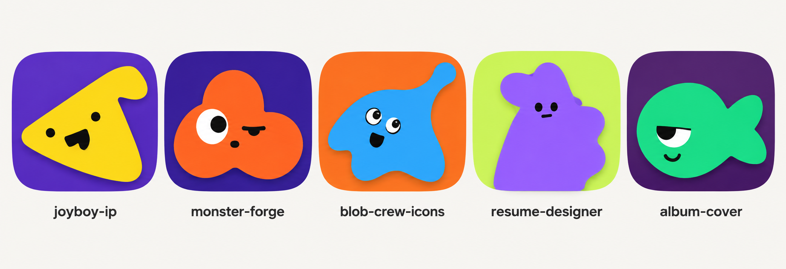

AI-generated style exploration, NOT output from the Python generator, references for family direction.

## Approved Skill-cover icons

These five covers use custom vectors plus the original compositor. They are cover artwork for five skills, not a claim that Blob Crew generated Joyboy, Monster, resume, or album content.

| Cover | PNG | SVG |
| --- | --- | --- |
| joyboy-ip | <a href="./skill-icons/joyboy-ip/icon-1024.png">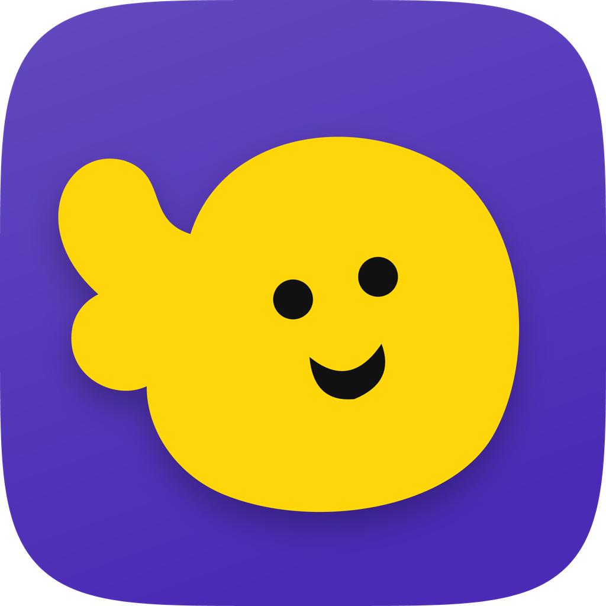</a> | [icon.svg](./skill-icons/joyboy-ip/icon.svg) |
| monster-forge | <a href="./skill-icons/monster-forge/icon-1024.png">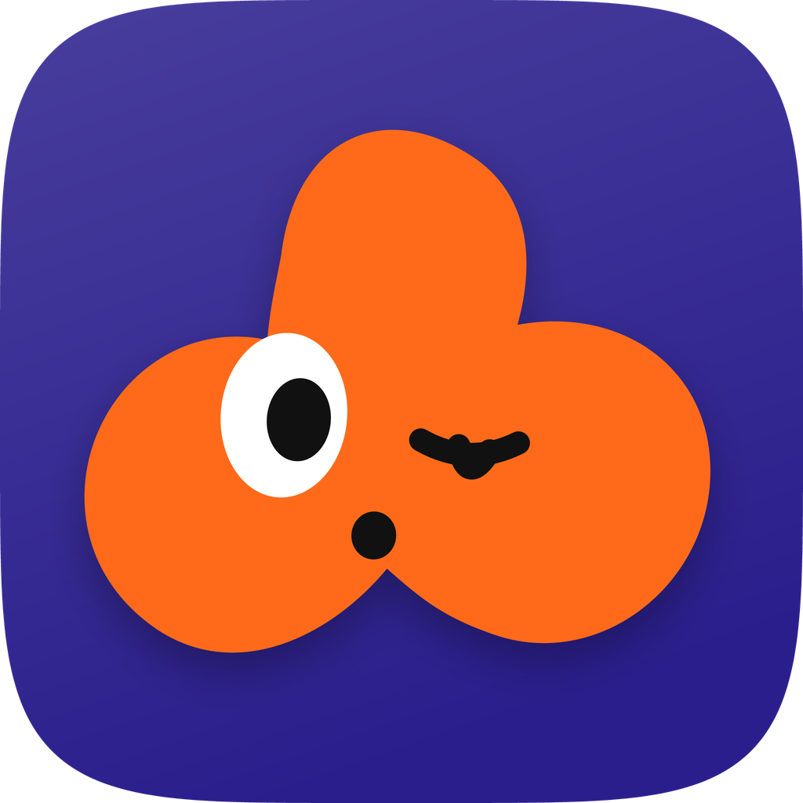</a> | [icon.svg](./skill-icons/monster-forge/icon.svg) |
| blob-crew-icons | <a href="./skill-icons/blob-crew-icons/icon-1024.png"></a> | [icon.svg](./skill-icons/blob-crew-icons/icon.svg) |
| resume-designer | <a href="./skill-icons/resume-designer/icon-1024.png">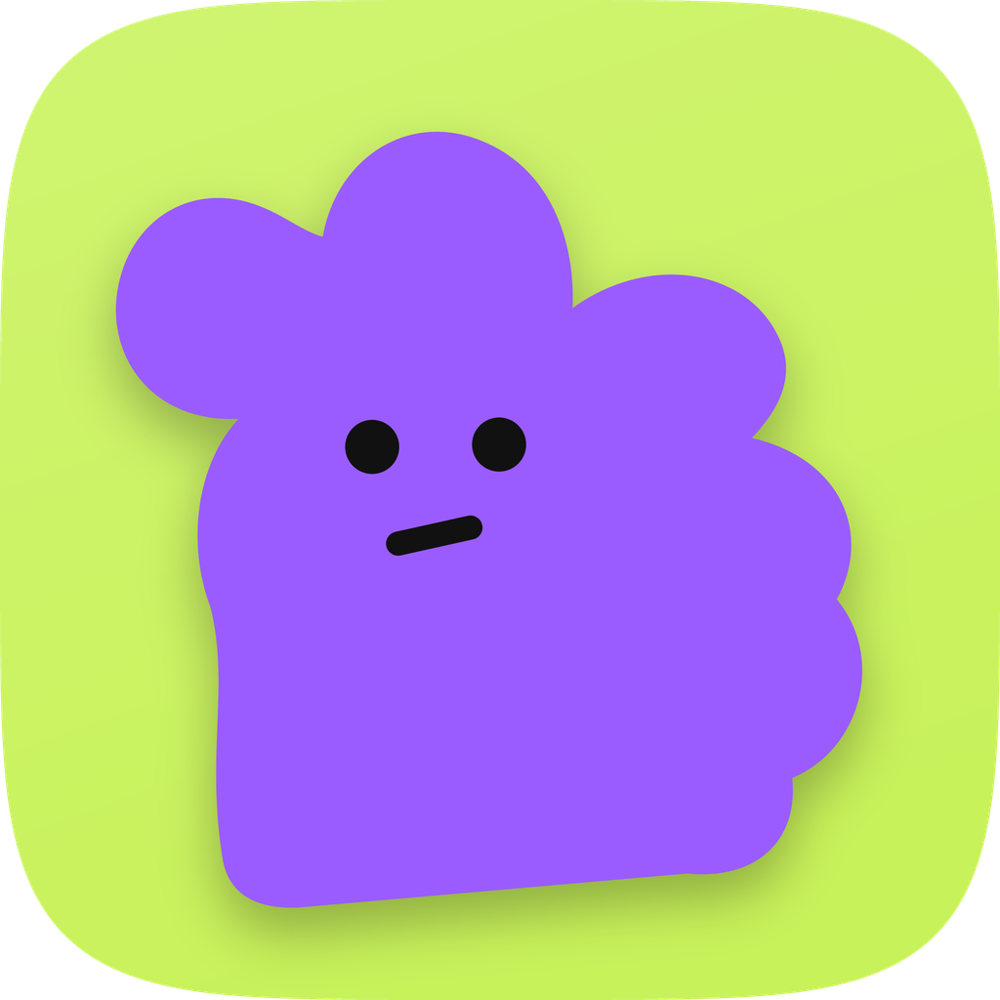</a> | [icon.svg](./skill-icons/resume-designer/icon.svg) |
| album-cover | <a href="./skill-icons/album-cover/icon-1024.png">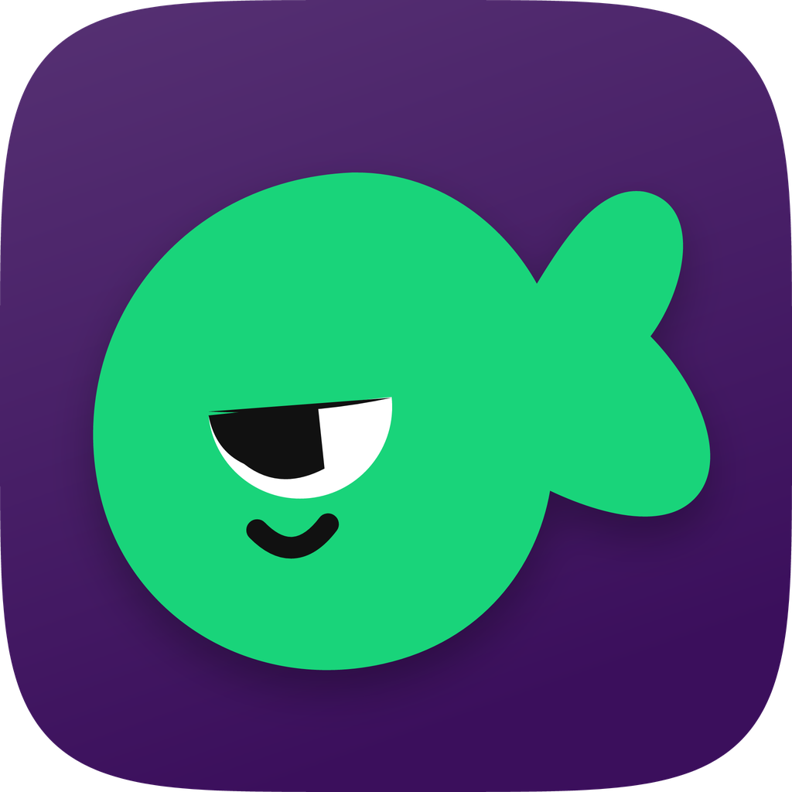</a> | [icon.svg](./skill-icons/album-cover/icon.svg) |

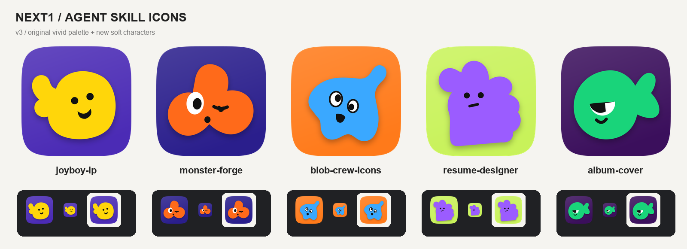

## Blob Crew project tests

These are five fictional project-test outputs from the original compositor and new test configs. They are not Skill-logo icons.

| Project | PNG | SVG |
| --- | --- | --- |
| 研究侦察 / Research scout | <a href="./project-icons/01-research-scout.png">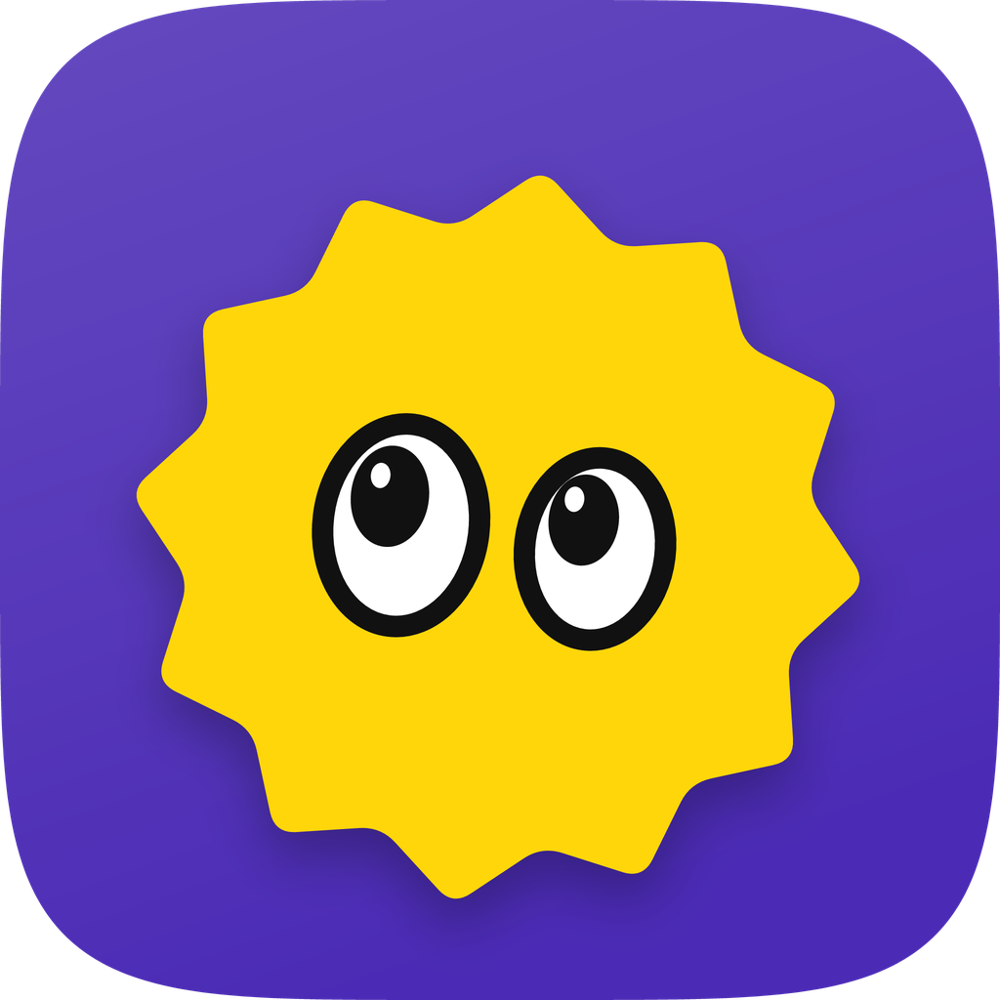</a> | [SVG](./project-icons/01-research-scout.svg) |
| 语音收件箱 / Voice inbox | <a href="./project-icons/02-voice-inbox.png"></a> | [SVG](./project-icons/02-voice-inbox.svg) |
| 剪辑整理 / Clip organizer | <a href="./project-icons/03-clip-organizer.png">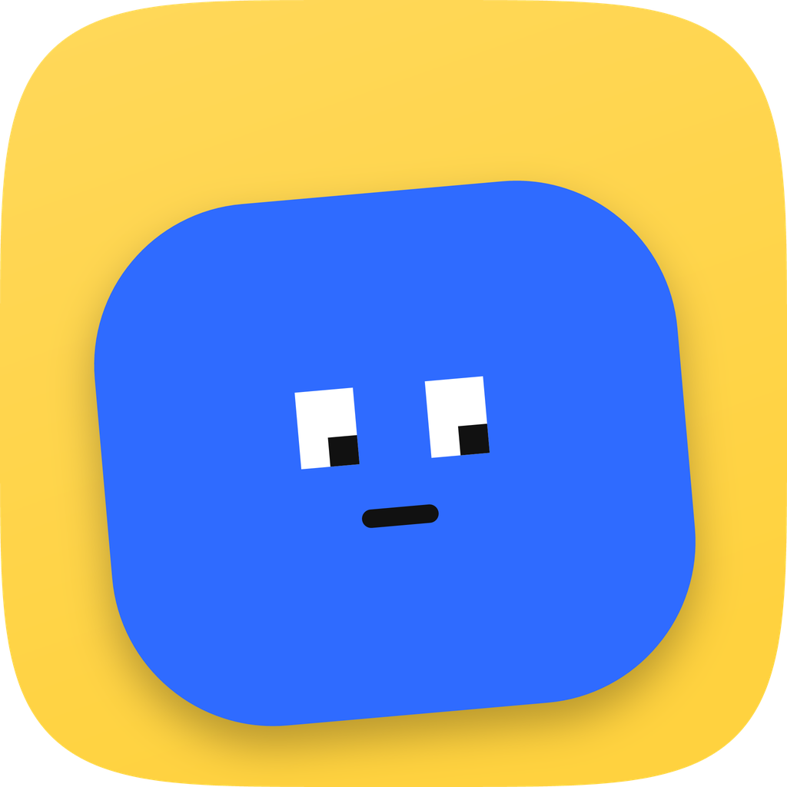</a> | [SVG](./project-icons/03-clip-organizer.svg) |
| 专注助手 / Focus helper | <a href="./project-icons/04-focus-helper.png"></a> | [SVG](./project-icons/04-focus-helper.svg) |
| Agent 邮箱 / Agent mail | <a href="./project-icons/05-agent-mail.png">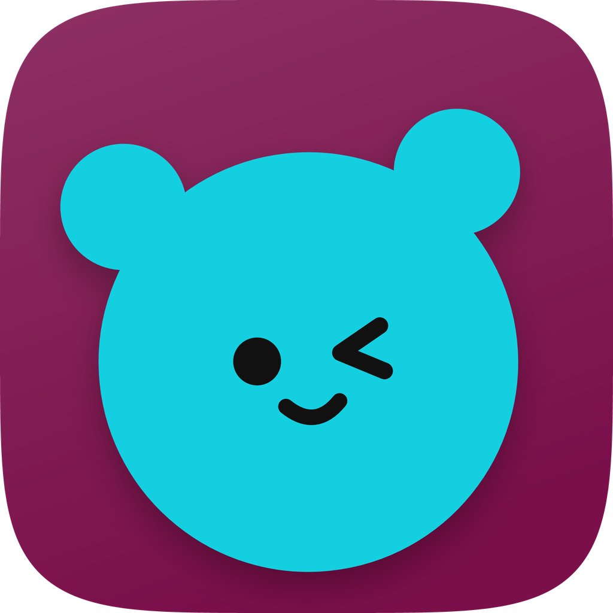</a> | [SVG](./project-icons/05-agent-mail.svg) |

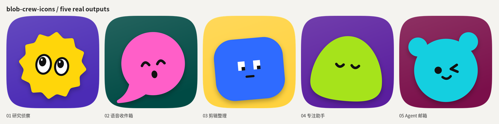

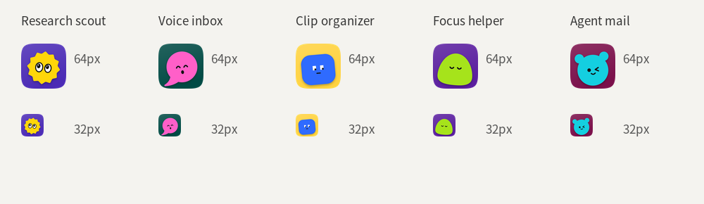

The project-test images are five fictional capability tests: Research scout, Voice inbox, Clip organizer, Focus helper, and Agent mail. The contact sheet and small-size proof are review aids; they are not additional generated icons.

## Reproduction

Run these commands from this Skill directory (`skills/blob-crew-icons/` in the repository, or the copied Skill directory):

```bash
python -m pip install -r requirements.txt
python scripts/crew.py deep
python examples/project-icons.py --output ./example-output/project-icons
python examples/skill-icons.py --output ./example-output/skill-icons
```

The examples locate the original compositor relative to the copied Skill directory, do not fetch assets, and do not require the source repository as a parent. See [`manifest.json`](./manifest.json) for the relative asset inventory and dimensions.
